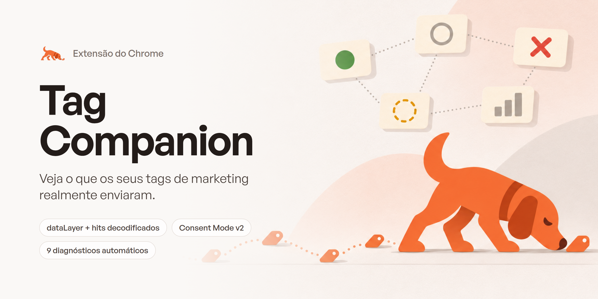
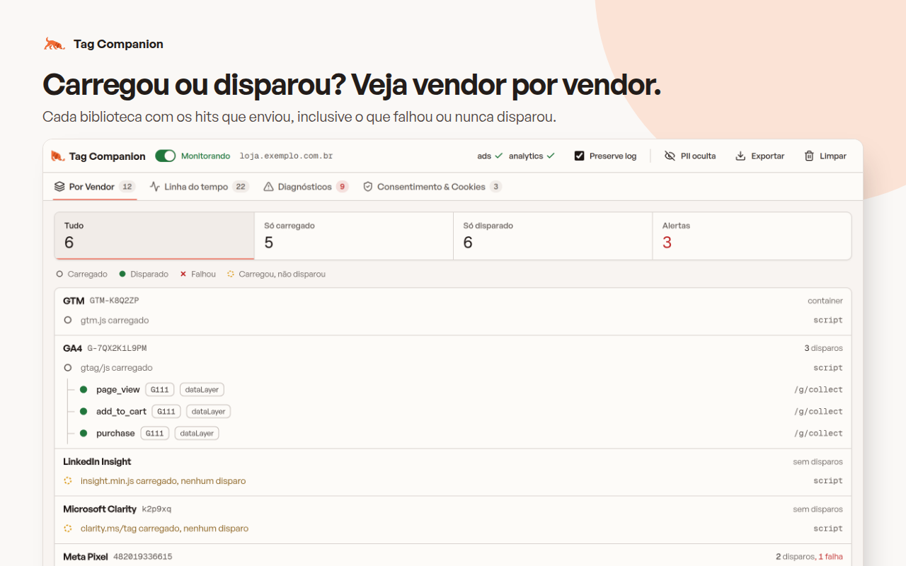
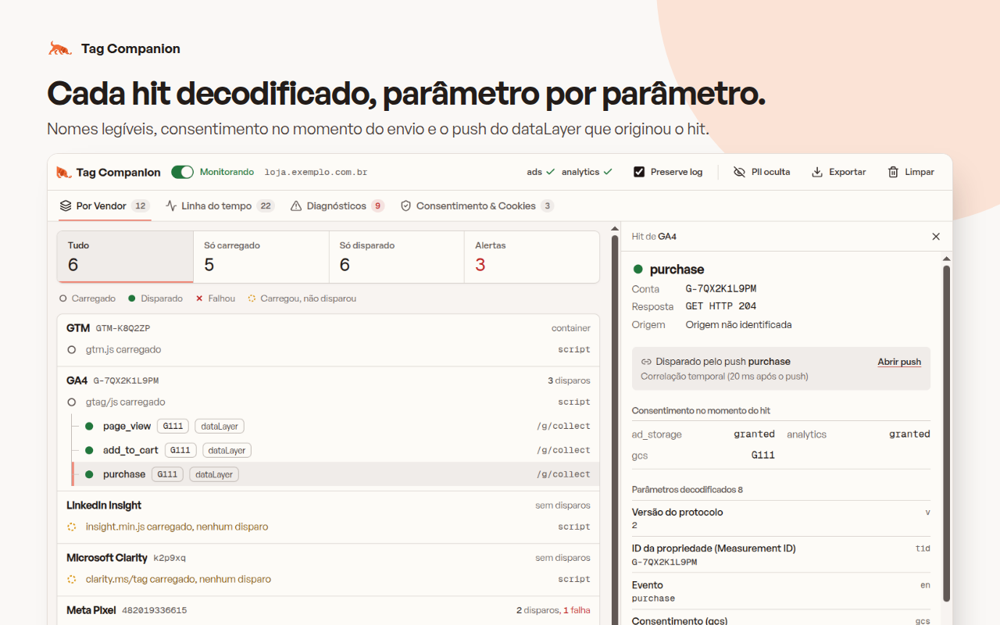
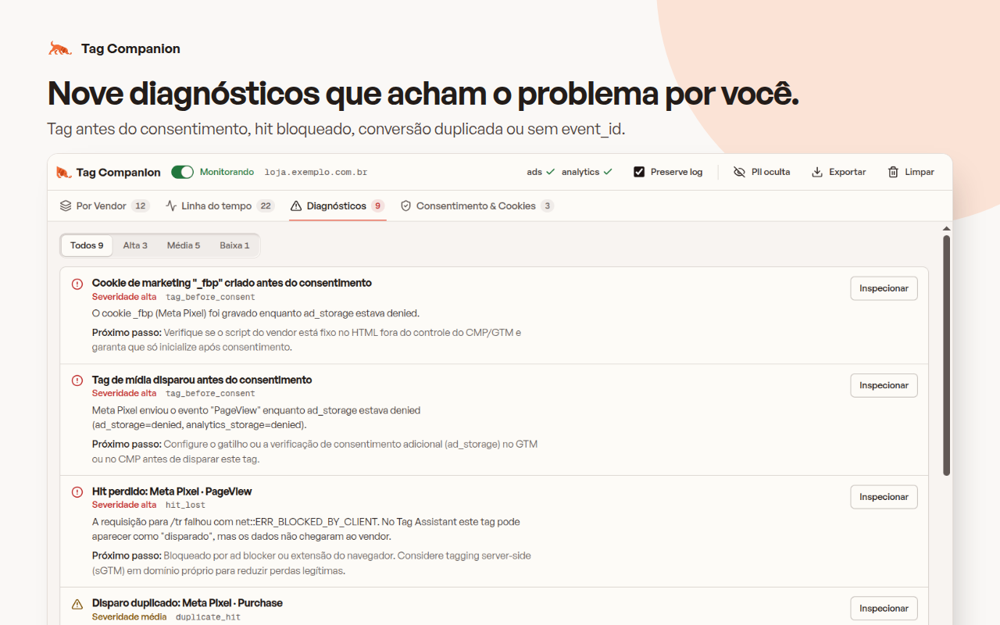
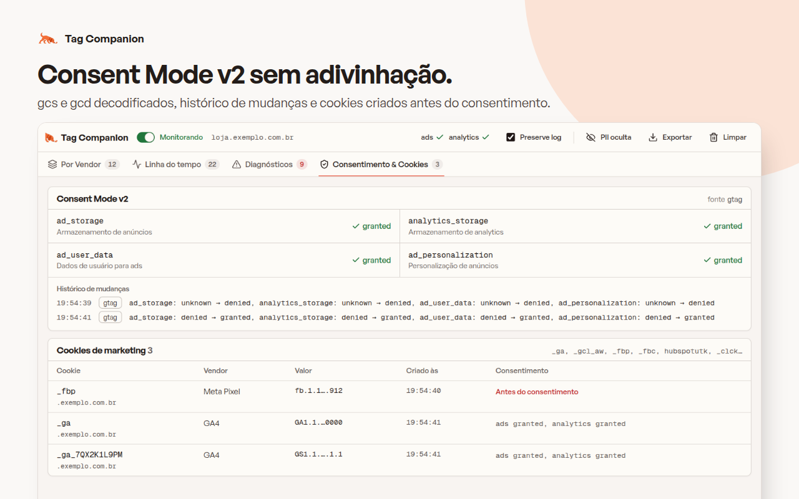
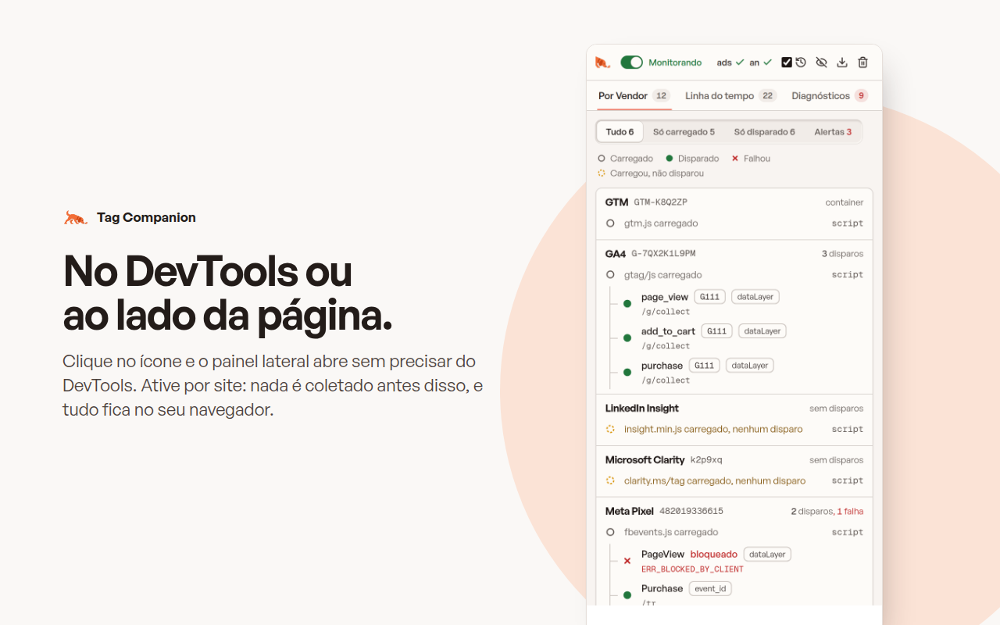
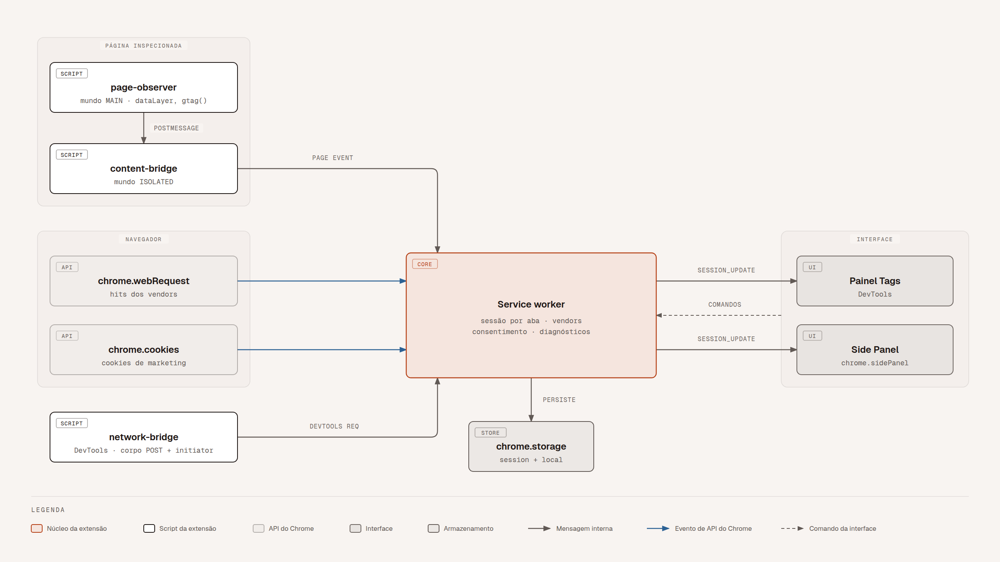
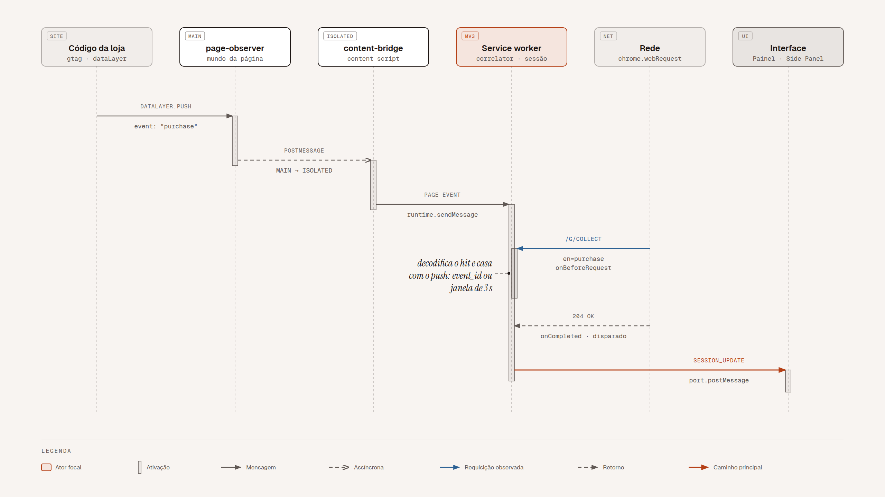
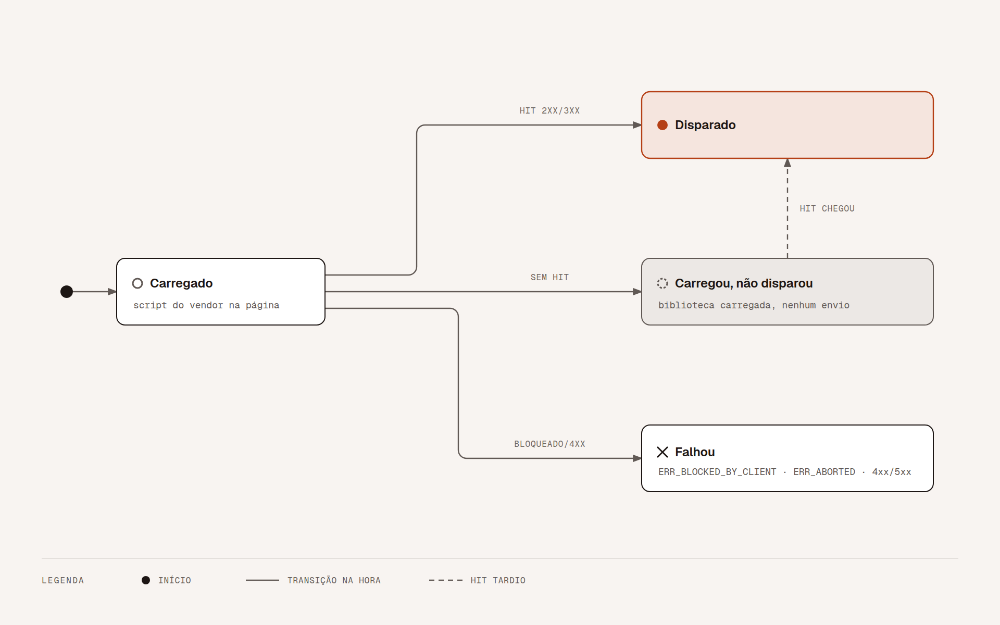
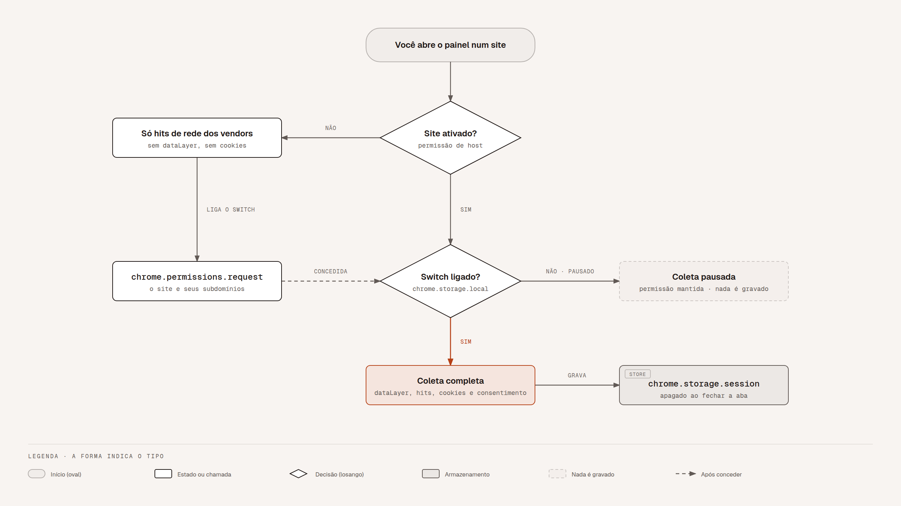

<p align="center">
  
</p>

<p align="center">
  
  
  
</p>

**O Tag Companion mostra o que os seus tags de marketing realmente enviaram.** O Tag Assistant diz o que o GTM *decidiu* disparar; o Tag Companion olha a rede e a página e mostra se o hit saiu, se chegou, se foi bloqueado, se saiu antes do consentimento ou se saiu duas vezes. Funciona até com tags que não passam pelo GTM.

É grátis, roda inteiro no seu navegador e não envia nada para servidor nenhum. **Site:** https://rafaelfariaferreira.github.io/tag-companion/

## Instalar

### Pela Chrome Web Store

A extensão está em análise na Chrome Web Store. Assim que for publicada, o link aparece aqui e a instalação fica em um clique.

### Enquanto isso, instale manualmente

1. Baixe o [`tag-companion.zip`](https://github.com/RafaelFariaFerreira/tag-companion/releases/download/v0.1.4/tag-companion.zip) (v0.1.4) e descompacte numa pasta.
2. No Chrome, abra `chrome://extensions`.
3. Ligue o **Modo do desenvolvedor**, no canto superior direito.
4. Clique em **Carregar sem compactação** e escolha a pasta descompactada.
5. Fixe o ícone do cão na barra do Chrome (no ícone de quebra-cabeça).

### Primeiros passos

1. Abra o site que você quer auditar.
2. Clique no ícone do Tag Companion. O painel abre ao lado da página. Se preferir, abra o DevTools e vá na aba **Tags**.
3. Clique em **Ativar neste site** e recarregue a página.
4. Navegue, clique, envie formulários. Tudo aparece em tempo real.

Para parar de observar um site sem perder a permissão, desligue o switch ao lado da logo.

## O que você vê



**Por vendor.** Cada biblioteca carregada, com os hits que ela disparou logo abaixo. O que falhou ou nunca disparou fica marcado.



**Inspetor.** Clique em qualquer hit para ver os parâmetros com nomes legíveis, o consentimento no momento do envio e o push do `dataLayer` que o originou.



**Diagnósticos.** A extensão acha os problemas sozinha: tag antes do consentimento, hit bloqueado, conversão sem hit, disparo duplicado, conversão sem `event_id` e mais.



**Consentimento e cookies.** `gcs` e `gcd` decodificados, o histórico de mudanças e os cookies de marketing criados antes do consentimento.



**No DevTools ou ao lado da página.** A mesma interface nos dois lugares.

**Vendors suportados:** GTM e sGTM, GA4, Google Ads, Meta Pixel, LinkedIn Insight, HubSpot, Microsoft Clarity, TikTok, Reddit, X e Mixpanel.

## Perguntas frequentes

**Meus dados vão para algum lugar?** Não. Tudo fica no seu navegador e a sessão de cada aba é apagada quando você fecha a aba. E-mails, telefones e hashes aparecem mascarados na tela e no arquivo exportado.

**A extensão fica observando para sempre?** Ela observa só os sites que você ativou, em toda visita, até você desligar o switch ou remover o acesso em `chrome://extensions`. Nos outros sites ela não injeta nada.

**Por que pede permissão site por site?** Para não precisar de acesso a todos os sites na instalação. Você decide onde ela atua.

**Preciso abrir o DevTools?** Não. O painel lateral abre pelo ícone. O DevTools é útil quando você quer o corpo completo das requisições POST.

---

# Para desenvolvedores

O Tag Companion é código aberto sob a [licença MIT](LICENSE). Issues e pull requests são bem-vindos.

## Rodar localmente

```bash
pnpm install
pnpm test          # testes (Vitest)
pnpm build         # gera dist/
pnpm preview:ui    # a interface com dados de exemplo, sem precisar da extensão
```

- **Carregar a extensão:** `chrome://extensions` → **Carregar sem compactação** → pasta `dist/`.
- **Preview:** abre em `http://localhost:5199/preview/index.html`. Parâmetros: `?mode=sidepanel` para o painel estreito, `&nogrant` para o estado sem permissão. Os dados do preview são fictícios.
- **Página de teste:** `npx serve demo` serve `demo/test-site.html`, com cenários de tags para disparar.

**Stack:** TypeScript, React 19, Tailwind CSS 4, Vite e Vitest. O núcleo (`src/core/`) é TypeScript puro, sem APIs do Chrome, e é ele que concentra os testes.

## Arquitetura

Tudo o que a extensão coleta converge para o **service worker**, que mantém uma sessão por aba e a transmite para a interface.



| Peça | Arquivo | Papel |
| --- | --- | --- |
| Service worker | `src/background/service-worker.ts` | Escuta a rede, os cookies e as mensagens; guarda a sessão por aba; grava e registra os scripts de observação só nos sites ativados. |
| Observador da página | `src/collectors/page-observer-core.ts` | Roda no mundo `MAIN` em `document_start`; envolve `dataLayer.push` e `gtag()` e detecta globais de vendors. |
| Ponte de conteúdo | `src/collectors/content-bridge.ts` | Mundo `ISOLATED`: recebe o `postMessage` da página e repassa ao service worker. |
| Ponte do DevTools | `src/devtools/network-bridge.ts` | Completa os hits com o corpo POST inteiro e a pilha do initiator, usada para saber se o tag veio do GTM. |
| Interface | `src/ui/` | React; a mesma árvore para o painel do DevTools e o painel lateral. |

### O caminho de um evento



O observador roda no mundo `MAIN` porque só ali enxerga o `dataLayer` da página. Ele não fala direto com a extensão; quem faz isso é a ponte no mundo `ISOLATED`. Por isso a extensão vê tags fora do GTM: um `fbq('track')` fixo no HTML ou um `dataLayer.push` feito pelo React aparecem igual.

### Os quatro estados de um tag



Na interface, cada estado tem uma forma própria (anel, disco, X, anel tracejado), para continuar legível sem depender só da cor.

### Permissão por site e o switch



- Os domínios dos vendors vêm declarados no `manifest.json`. O site auditado fica em `optional_host_permissions` e só é pedido quando o usuário ativa, valendo para o site e seus subdomínios (nunca para um sufixo como `.com.br`).
- A extensão só grava nos sites ativados (`src/shared/site-access.ts`). Desligar o switch remove a permissão de **todos** os sites; ao ligar de novo, ela pede permissão só para o site aberto. Ex.: com `uol.com` e `globo.com` ativados, desligar limpa os dois; ativar no `uol.com` volta a gravar só nele, e o `globo.com` só volta se for ativado de novo.

### Núcleo

| Módulo | Responsabilidade |
| --- | --- |
| `session-store.ts` | Estado da sessão: registra requisições, eventos da página, cookies e navegações; monta os grupos "Por vendor". |
| `consent.ts` | Decodifica `gcs`, `gcd`, comandos `gtag('consent')` e `google_tag_data.ics`. |
| `correlator.ts` | Liga cada push do `dataLayer` aos hits que ele gerou: `event_id` exato ou janela de 3 s, com equivalências como `purchase` ↔ `conversion` ↔ `CompletePayment`. |
| `diagnostics.ts` | As nove regras automáticas (tabela abaixo). |
| `pii.ts` · `exporter.ts` | Detecta e mascara PII; gera o JSON exportado, sempre mascarado. |

### Diagnósticos

| Regra | O que detecta |
| --- | --- |
| `tag_before_consent` | Hit de mídia ou cookie de marketing com `ad_storage = denied` (o ping sem cookies do GA4, `gcs=G100`, é aceito). |
| `hit_lost` | `ERR_ABORTED`, `ERR_BLOCKED_BY_CLIENT` ou HTTP 4xx/5xx. |
| `event_without_hit` | Evento de conversão no `dataLayer` sem hit em 5 s. |
| `duplicate_hit` | O mesmo evento ao mesmo vendor em 2 s, ou pelo GTM e por um script fixo. |
| `missing_dedup_key` | Conversão sem `eid` / `event_id` para deduplicar com a API de conversões. |
| `wrong_property` | Mais de uma propriedade GA4 ou container GTM na página. |
| `pii_in_url` | E-mail ou telefone em texto puro na URL do hit. |
| `click_id_not_stored` | `gclid` / `fbclid` na URL sem o cookie `_gcl_aw` / `_fbc` depois de 3 s. |
| `loaded_no_fire` | Biblioteca carregada que nunca disparou. |

## Adicionar um vendor

Cada vendor é um módulo em `src/vendors/` com a mesma interface:

```ts
export interface VendorModule {
  id: VendorId;
  name: string;
  category: VendorCategory;                                       // tag_manager | analytics | ads | crm | session_replay
  match(url: string, resourceType?: string): VendorMatch | null;  // é script ou hit?
  parse(request: RawNetworkRequest): ParsedHit[];                 // um request pode ter vários hits (lotes do GA4)
  label(param: string): string;                                   // "epn.value" → "Evento (num): value"
}
```

1. Crie `src/vendors/<vendor>.ts` implementando a interface.
2. Registre-o em `VENDOR_MODULES`, em `src/vendors/index.ts`, e o id em `VendorId` (`src/shared/types.ts`).
3. Adicione os domínios do vendor em `host_permissions`, no `manifest.json`.
4. Escreva os testes em `tests/vendors.test.ts` com URLs reais do vendor.

## Estrutura

```text
tag-companion/
├── manifest.json          # MV3: permissões, side panel, devtools_page
├── src/
│   ├── background/        # service worker e coletor de cookies
│   ├── collectors/        # observador MAIN e ponte ISOLATED
│   ├── devtools/          # painel "Tags" e ponte de rede
│   ├── core/              # sessão, consentimento, correlação, diagnósticos, PII
│   ├── vendors/           # um módulo por vendor
│   ├── shared/            # tipos, constantes e regra de acesso por site
│   └── ui/                # React: componentes e tokens de design
├── preview/               # UI com dados de exemplo
├── tests/                 # Vitest
├── demo/                  # página de teste
└── docs/                  # imagens, prints e diagramas (docs/diagrams/*.html)
```

## Contribuir

1. Faça um fork e crie uma branch a partir da `main`.
2. Rode `pnpm test` e `pnpm build` antes de abrir o pull request.
3. Para mudanças na interface, anexe um print do `pnpm preview:ui` no PR.
4. Mantenha o princípio do projeto: nada sai do navegador e nada é coletado sem o usuário ativar o site.

Os diagramas desta página têm a versão editável em HTML em [`docs/diagrams/`](docs/diagrams).

## Licença

[MIT](LICENSE) © 2026 Rafael Ferreira
