<p align="center">
  
</p>

<p align="center">
  <strong>Veja o que os seus tags de marketing <em>realmente</em> enviaram.</strong><br>
  Extensão do Chrome (Manifest V3) para quem implementa e audita GTM, GA4, Meta Pixel, Google Ads e cia.
</p>

<p align="center">
  
  
  
  
</p>

---

O Tag Assistant mostra o que o GTM *decidiu* disparar. O **Tag Companion** mostra o que saiu de verdade pela rede: cada push do `dataLayer`, cada hit decodificado, o estado do Consent Mode v2, os cookies de marketing e nove diagnósticos automáticos — inclusive de tags fixos no código, fora do GTM.

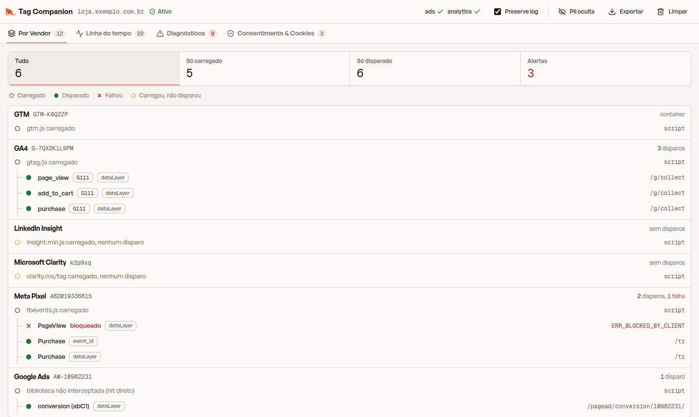

## Sumário

- [O que ele mostra](#o-que-ele-mostra)
- [Os quatro estados de um tag](#os-quatro-estados-de-um-tag)
- [Arquitetura](#arquitetura)
  - [Visão geral](#visão-geral)
  - [O caminho de um evento](#o-caminho-de-um-evento)
  - [Coleta em três mundos](#coleta-em-três-mundos)
  - [Núcleo: da requisição ao diagnóstico](#núcleo-da-requisição-ao-diagnóstico)
  - [Módulos de vendor](#módulos-de-vendor)
  - [Permissões e privacidade](#permissões-e-privacidade)
- [Diagnósticos automáticos](#diagnósticos-automáticos)
- [Estrutura do projeto](#estrutura-do-projeto)
- [Como rodar](#como-rodar)

## O que ele mostra

| Aba | Para que serve |
| --- | --- |
| **Por Vendor** | Cada biblioteca carregada com os hits que ela disparou logo abaixo. Os números no topo filtram a lista (tudo, só carregado, só disparado, alertas). |
| **Linha do tempo** | `dataLayer`, hits, scripts, consentimento, cookies e navegações em ordem cronológica, com busca. |
| **Diagnósticos** | Os problemas que a extensão encontrou sozinha, com severidade e próximo passo. |
| **Consentimento & Cookies** | Estado atual do Consent Mode v2 (`gcs`, `gcd`), histórico de mudanças e cookies de marketing criados antes ou depois do consentimento. |

Clicar em qualquer item abre o **inspetor**: parâmetros decodificados com nome legível, consentimento no momento do hit, o push do `dataLayer` que o originou e a URL completa.

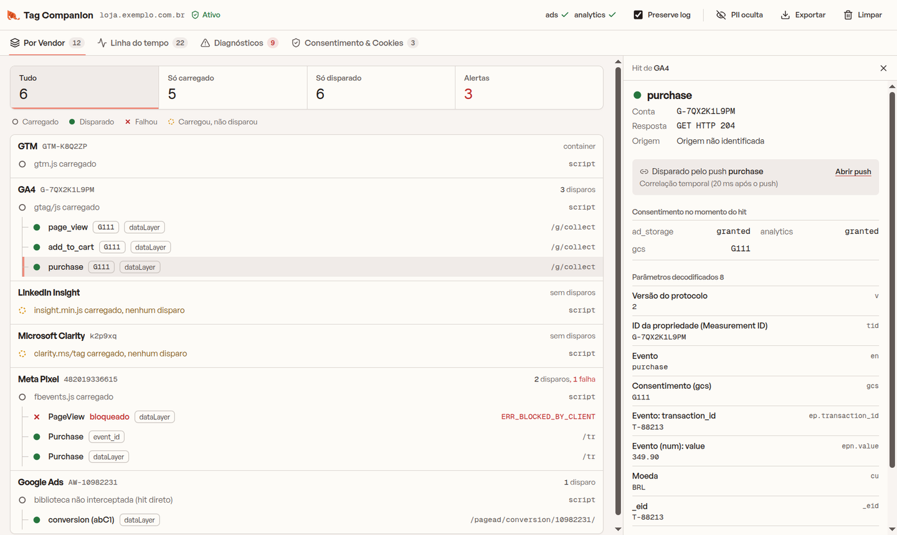

Funciona em dois lugares, com a mesma interface:

<table>
  <tr>
    <td width="62%">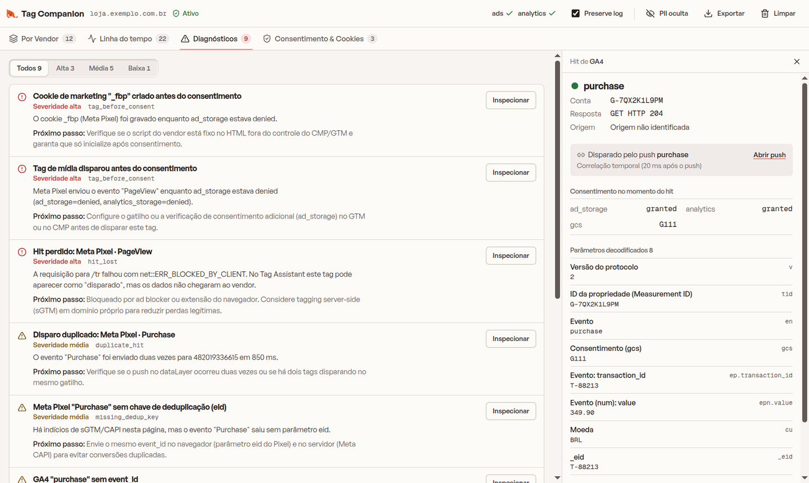</td>
    <td width="38%">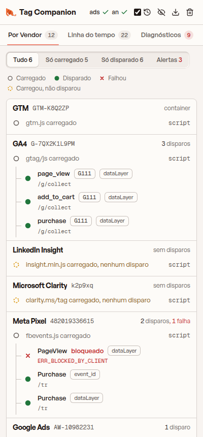</td>
  </tr>
  <tr>
    <td align="center"><b>DevTools → aba Tags</b><br>tela larga, inspetor ao lado</td>
    <td align="center"><b>Side Panel</b><br>clique no ícone da extensão</td>
  </tr>
</table>

## Os quatro estados de um tag

A forma diz o estado antes da cor, para continuar legível para quem não distingue vermelho de verde.

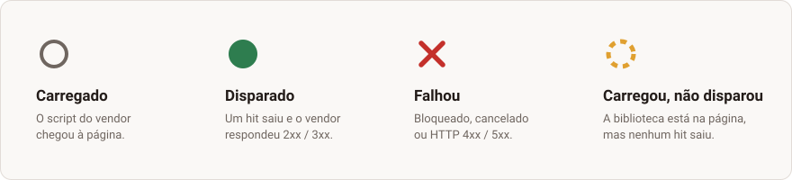

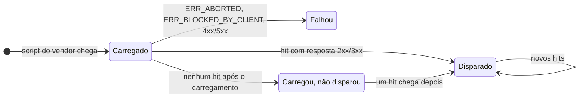

## Arquitetura

### Visão geral

A extensão tem quatro peças que conversam por mensagens do Chrome. Tudo o que é coletado converge para o **service worker**, que mantém uma sessão por aba e a transmite em tempo real para a interface.

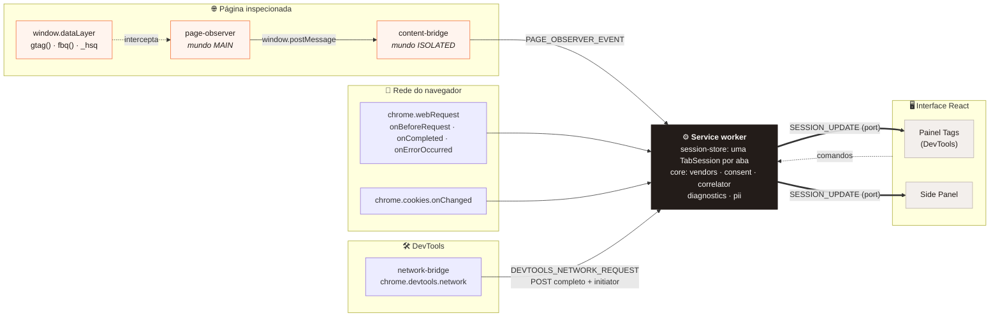

As mensagens trocadas (`RuntimeMessage` em `src/shared/types.ts`):

| Mensagem | De → para | Para quê |
| --- | --- | --- |
| `PAGE_OBSERVER_EVENT` | content-bridge → service worker | Push do `dataLayer`, comando de consentimento, global de vendor, contexto da página. |
| `DEVTOOLS_NETWORK_REQUEST` | network-bridge → service worker | Requisição com corpo POST completo e pilha do initiator. |
| `SESSION_UPDATE` | service worker → interface | A sessão inteira da aba, a cada mudança. |
| `GET_SESSION` · `CLEAR_SESSION` · `SET_PRESERVE_LOG` | interface → service worker | Carregar, limpar e manter o registro entre navegações. |
| `ACTIVATE_ORIGIN` · `CHECK_ORIGIN_PERMISSION` | interface → service worker | Ativar a observação no site atual. |

| Peça | Arquivo | Papel |
| --- | --- | --- |
| Service worker | `src/background/service-worker.ts` | Escuta rede, cookies e mensagens; guarda a sessão por aba em `chrome.storage.session`; registra os scripts de observação só nos sites ativados. |
| Observador da página | `src/collectors/page-observer-core.ts` | Roda no mundo `MAIN` em `document_start`, envolve `dataLayer.push` e `gtag()` e detecta globais de vendors. |
| Ponte de conteúdo | `src/collectors/content-bridge.ts` | Mundo `ISOLATED`: recebe o `postMessage` da página e repassa ao service worker. |
| Ponte do DevTools | `src/devtools/network-bridge.ts` | Completa os hits com o corpo POST inteiro (lotes do GA4) e a pilha do initiator, usada para saber se o tag veio do GTM. |
| Interface | `src/ui/` | React 19 + Tailwind 4, a mesma árvore para o painel do DevTools e o Side Panel. |

### O caminho de um evento

Um `purchase` empurrado pelo código da loja, do `dataLayer.push` até a tela:

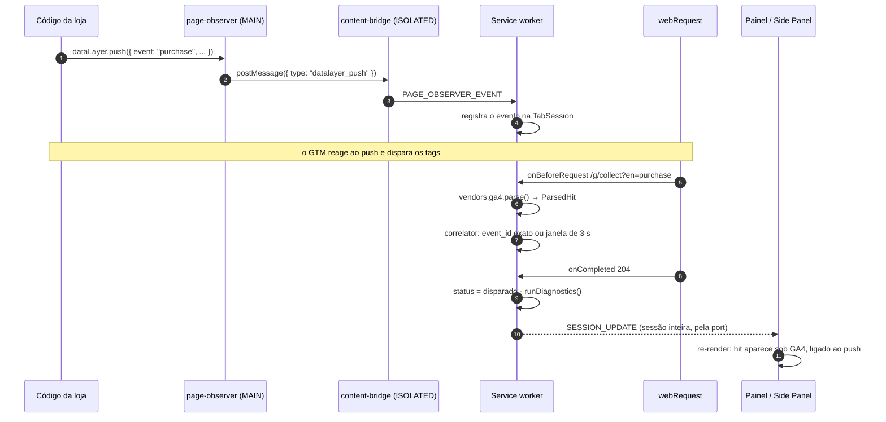

### Coleta em três mundos

O Chrome isola o JavaScript da extensão do JavaScript da página. Para ler o `dataLayer` *e* falar com o service worker, a coleta é feita em três camadas:

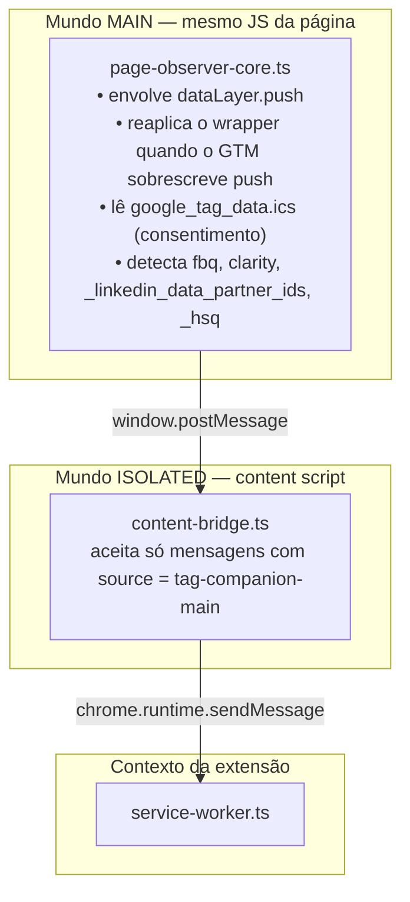

Por isso a extensão enxerga tags que **não** passam pelo GTM: um `fbq('track')` fixo no HTML ou um `dataLayer.push` feito pelo React aparecem igual, e o initiator de cada requisição diz se o hit veio do `gtm.js`, de um sGTM em domínio próprio ou de um script fixo na página.

### Núcleo: da requisição ao diagnóstico

Tudo em `src/core/` é TypeScript puro, sem APIs do Chrome, e por isso é coberto por testes unitários.

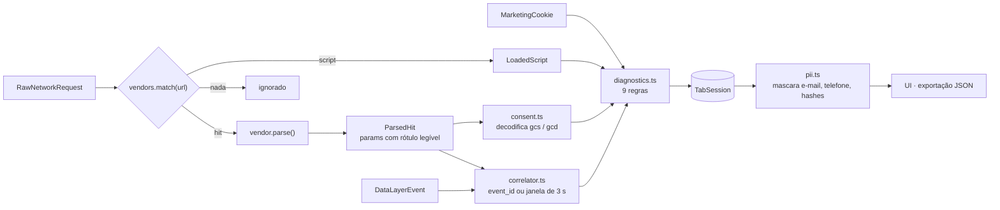

| Módulo | Responsabilidade |
| --- | --- |
| `session-store.ts` | Máquina de estado da sessão: registra requisições, eventos da página, cookies e navegações; monta os grupos "Por Vendor". |
| `consent.ts` | Decodifica `gcs` e `gcd` do Consent Mode v2, comandos `gtag('consent')` e `google_tag_data.ics`. |
| `correlator.ts` | Liga cada push do `dataLayer` aos hits que ele gerou: `event_id` exato ou janela de 3 s, com equivalências semânticas (`purchase` ↔ `conversion` ↔ `CompletePayment`). |
| `diagnostics.ts` | As nove regras automáticas (tabela abaixo). |
| `pii.ts` | Detecta e mascara PII na tela e na exportação. |
| `exporter.ts` | Gera o JSON da sessão, sempre com PII mascarada. |

### Módulos de vendor

Cada vendor é um módulo independente com a mesma interface. Adicionar um vendor novo é escrever um arquivo e registrá-lo em `src/vendors/index.ts`.

```ts
export interface VendorModule {
  id: VendorId;
  name: string;
  category: VendorCategory;              // tag_manager | analytics | ads | crm | session_replay
  match(url: string, resourceType?: string): VendorMatch | null;  // é script ou hit?
  parse(request: RawNetworkRequest): ParsedHit[];                 // um request pode ter N hits (lotes do GA4)
  label(param: string): string;                                   // "epn.value" → "Evento (num): value"
}
```

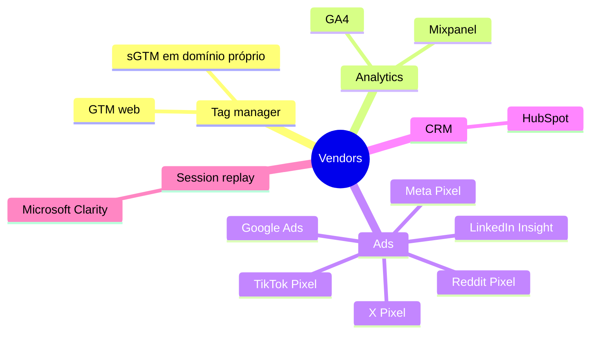

### Permissões e privacidade

A extensão **não** pede `<all_urls>` na instalação. Os domínios dos vendors vêm declarados no manifesto; o site que você está depurando só é observado depois que você clica em **Ativar neste site**.

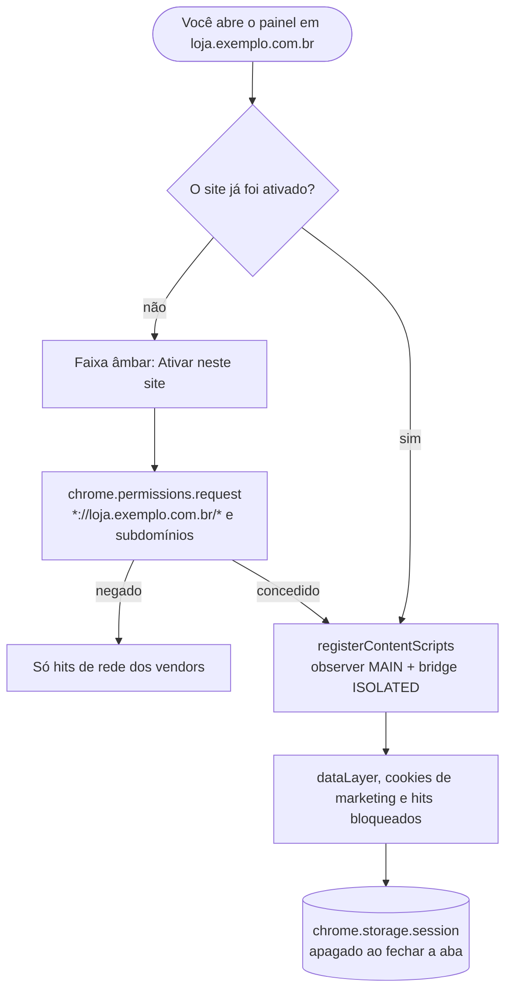

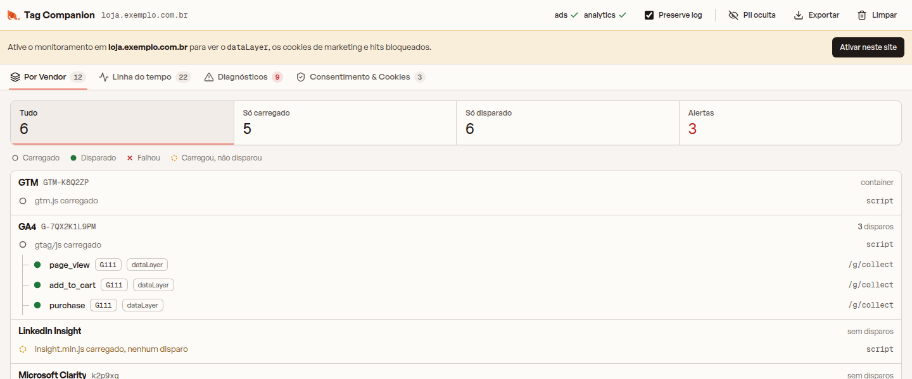

- **Tudo local:** nenhum dado sai do navegador; a sessão vive em `chrome.storage.session` e é apagada ao fechar a aba.
- **PII mascarada por padrão:** e-mails, telefones e hashes aparecem mascarados na tela e sempre mascarados no JSON exportado. O botão **PII oculta** revela os valores só na sua tela.

## Diagnósticos automáticos

| Regra | O que detecta | Severidade típica |
| --- | --- | --- |
| `tag_before_consent` | Hit de mídia ou cookie de marketing criado com `ad_storage = denied` (o ping sem cookies do GA4 com `gcs=G100` é aceito). | Alta |
| `hit_lost` | Requisição com `ERR_ABORTED`, `ERR_BLOCKED_BY_CLIENT` ou HTTP 4xx/5xx — aparece como "disparado" no Tag Assistant, mas não chegou ao vendor. | Alta |
| `event_without_hit` | Evento de conversão no `dataLayer` (`purchase`, `generate_lead`…) sem nenhum hit em 5 s. | Alta |
| `duplicate_hit` | O mesmo evento enviado duas vezes ao mesmo vendor em 2 s, ou pelo GTM e por um script fixo. | Média |
| `missing_dedup_key` | Conversão sem `eid` / `event_id`, necessária para deduplicar navegador e servidor (CAPI). | Média |
| `wrong_property` | Mais de uma propriedade GA4 ou container GTM na mesma página. | Média |
| `pii_in_url` | E-mail ou telefone em texto puro na URL do hit. | Alta |
| `click_id_not_stored` | `gclid` / `fbclid` na URL sem o cookie correspondente (`_gcl_aw`, `_fbc`) depois de 3 s. | Média |
| `loaded_no_fire` | Biblioteca carregada que nunca disparou. | Baixa |

## Estrutura do projeto

```text
tag-companion/
├── manifest.json              # MV3: permissões, side panel, devtools_page
├── devtools.html · panel.html · sidepanel.html
├── src/
│   ├── background/            # service worker + coletor de cookies
│   ├── collectors/            # observador MAIN e ponte ISOLATED
│   ├── devtools/              # registro do painel "Tags" e ponte de rede
│   ├── core/                  # sessão, consentimento, correlação, diagnósticos, PII, exportação
│   ├── vendors/               # um módulo por vendor
│   ├── shared/                # tipos e constantes
│   └── ui/                    # React: App, componentes, tokens de design
├── preview/                   # UI com dados de exemplo, sem precisar da extensão
├── tests/                     # Vitest
├── demo/test-site.html        # página com cenários de teste
├── public/icons · public/fonts
└── scripts/                   # build (Vite) e instalação
```

## Como rodar

```bash
pnpm install
pnpm test        # 30 testes: vendors, consentimento, correlação, diagnósticos, PII, sessão, observador
pnpm build       # gera dist/
```

1. Abra `chrome://extensions` e ative o **Modo do desenvolvedor**.
2. Clique em **Carregar sem compactação** e escolha a pasta `dist/`.
3. Abra um site (ou `npx serve demo` para a página de teste).
4. Clique no ícone do **Tag Companion** para o Side Panel, ou abra o DevTools → aba **Tags**.
5. Clique em **Ativar neste site** e recarregue a página.

**Mexendo só na interface?** `pnpm preview:ui` abre a UI com uma sessão de exemplo em `http://localhost:5199/preview/index.html` (`?mode=sidepanel` para o painel estreito, `&nogrant` para o estado sem permissão). Os dados do preview são fictícios.
